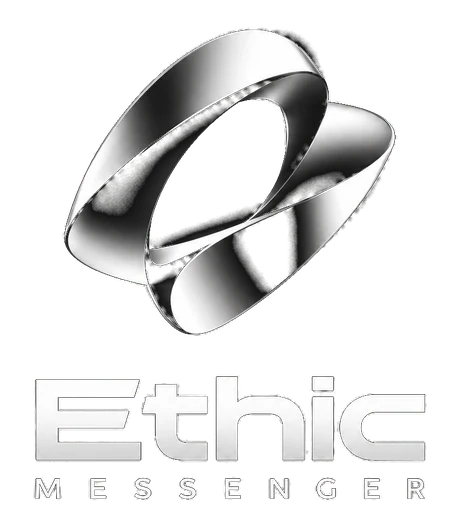
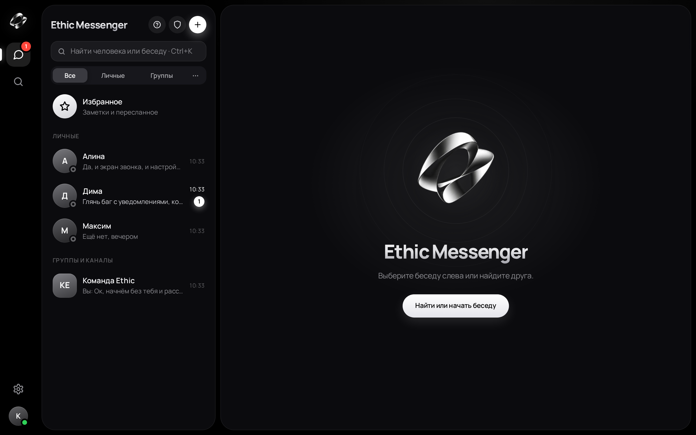
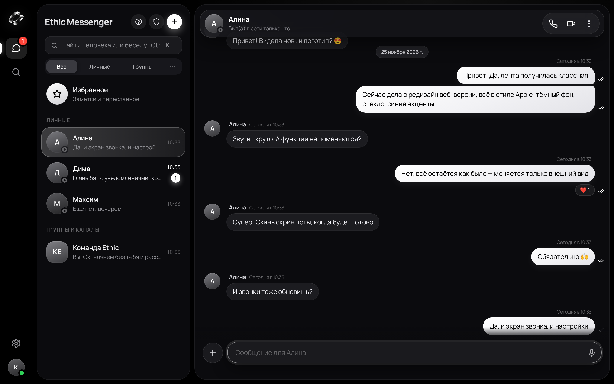
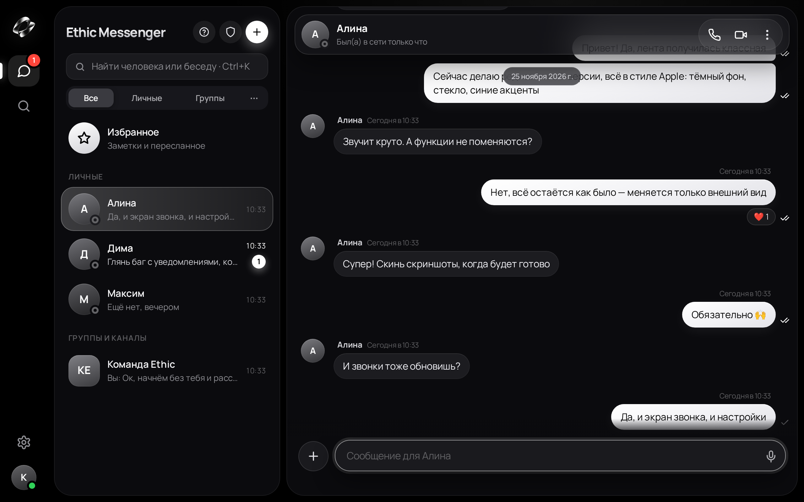
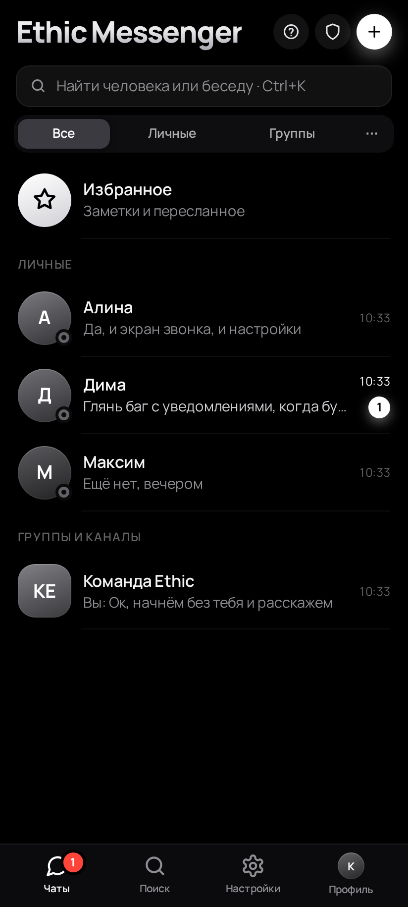
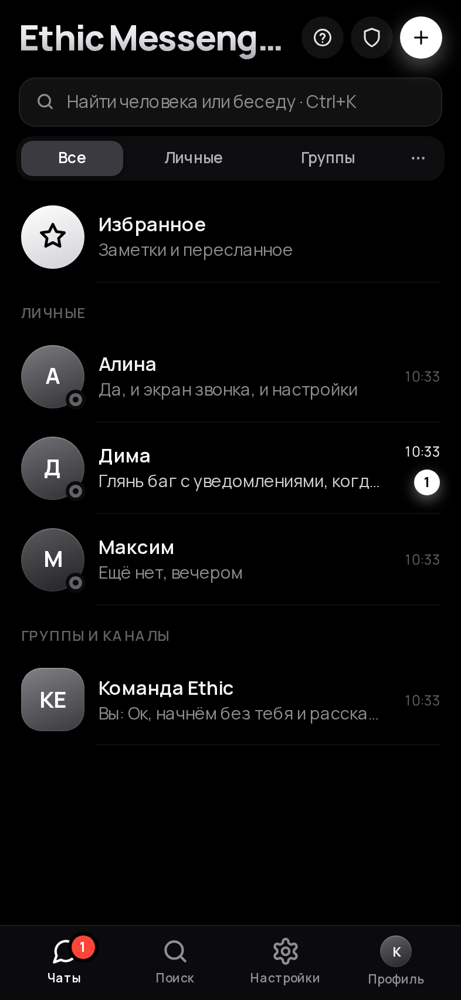

<p align="center">
  
</p>

# Ethic Messenger

Мессенджер с чатами, голосовыми сообщениями, фото и файлами, аудио- и видеозвонками и шумоподавлением. Есть приложения для Android, iPhone и Windows, а также веб-клиент.

**Веб-версия:** [ethicmessenger.duckdns.org:8443](https://ethicmessenger.duckdns.org:8443)

## Возможности

- Чаты, голосовые сообщения, фото и файлы
- Аудио- и видеозвонки через [LiveKit](https://livekit.io) (WebRTC)
- Шумоподавление
- **Android** — нативное приложение на Kotlin + Jetpack Compose (Material 3, чёрно-белая тема). Звонки идут как настоящие телефонные: громкость звонка, работа в фоне с уведомлением, громкая связь, Bluetooth-гарнитуры. Push-уведомления через Firebase.
- **iPhone** — нативное приложение на SwiftUI. На iOS 26 интерфейс в стиле Liquid Glass (системные вкладки и панели, стеклянные кнопки звонка и поле ввода). Звонки через LiveKit Swift SDK.
- **Windows** — приложение на Electron: трей, уведомления, демонстрация экрана, установщик в один клик.
- **Веб** — клиент в браузере, тот же сервер и те же функции.

## Скриншоты

Веб-клиент (дизайн ноября 2026: тёмный фон, белые акценты). Снимки Android, iOS и Windows — это та же веб-версия на экранах такого размера, не нативные приложения.

<p align="center">
  
</p>

<p align="center">
  
</p>

<p align="center">
  
</p>

<p align="center">
  
  &nbsp;
  
</p>

## Установка

Готовые файлы — во вкладке **[Releases](../../releases/latest)**.

### Android

1. Скачайте `Ethic-Messenger.apk`.
2. Откройте файл и разрешите установку из этого источника.
3. При первом звонке разрешите доступ к микрофону и камере.

### Windows

Скачайте `Ethic-Messenger-Setup.exe` и запустите: установка в один клик, ярлык на рабочем столе. Приложение живёт в трее.

### iPhone / iPad

1. Скачайте `Ethic-Messenger.ipa`.
2. Установите через [Sideloadly](https://sideloadly.io) или [AltStore](https://altstore.io) со своим Apple ID.
3. С бесплатным Apple ID приложение работает 7 дней — потом переподпишите его в той же программе.

### Веб

Откройте [ethicmessenger.duckdns.org:8443](https://ethicmessenger.duckdns.org:8443) в браузере.

## Сборка

Сборка идёт автоматически в GitHub Actions (`.github/workflows/build.yml`): по тегу `v*` или вручную через **Actions → Сборка приложений → Run workflow**, с указанием версии. Android собирается на Ubuntu, подписывается ключом из секретов репозитория (`ANDROID_KEYSTORE_BASE64`, `ANDROID_KEYSTORE_PASSWORD`, `ANDROID_KEY_ALIAS`, `ANDROID_KEY_PASSWORD`; для push также нужен `GOOGLE_SERVICES_JSON`) и вместе с iOS и Windows выкладывается в релиз.

### Android

Локально: `cd android && ./gradlew assembleDebug`.

Debug-сборка ходит на локальный сервер `http://10.0.2.2:3999` (так эмулятор видит машину разработчика). Release ходит на `https://ethicmessenger.duckdns.org:8443`. Нужны JDK 17+ и Android SDK (compileSdk 37, minSdk 26). Файл `android/app/google-services.json` в репозиторий не входит — он нужен для Firebase Cloud Messaging.

### iOS

Проект генерируется [XcodeGen](https://github.com/yonaskolb/XcodeGen) из `ios/project.yml` (bundle id `com.ethic.messenger`, iOS 17+):

```bash
cd ios
xcodegen generate
```

Дальше откройте `Ethic.xcodeproj` в Xcode или соберите через `xcodebuild`. Интерфейс Liquid Glass появляется при сборке с Xcode 26 / iOS 26 SDK. В CI IPA собирается без подписи (`CODE_SIGNING_ALLOWED=NO`, приложение упаковывается в `Payload` и архивируется в `.ipa`) и выкладывается как артефакт. Секреты подписи iOS не нужны: IPA неподписанный, его ставят через Sideloadly или AltStore.

### Windows

```bash
cd desktop
npm ci
npm start          # запуск
npm run dist       # установщик Ethic-Messenger-Setup.exe
```

Нужен Node.js 22. Приложение открывает веб-клиент `https://ethicmessenger.duckdns.org:8443`.

## Структура

| Путь | Что это |
| --- | --- |
| `android/app/src/main/java/com/ethic/messenger/data/` | API, WebSocket, состояние приложения |
| `android/app/src/main/java/com/ethic/messenger/call/` | Звонки: LiveKit, фоновая служба |
| `android/app/src/main/java/com/ethic/messenger/media/` | Рингтоны и звуки, голосовые сообщения |
| `android/app/src/main/java/com/ethic/messenger/ui/` | Экраны на Jetpack Compose |
| `ios/project.yml` | Проект iOS (генерируется XcodeGen) |
| `ios/Ethic/` | Приложение iOS на SwiftUI |
| `desktop/` | Приложение Windows на Electron |
| `web/public/` | Исходники веб-клиента (без сервера) |
| `assets/` | Логотип и иконка |
| `docs/screenshots/` | Скриншоты веб-клиента |

Изменения по версиям — в [CHANGELOG.md](CHANGELOG.md).
